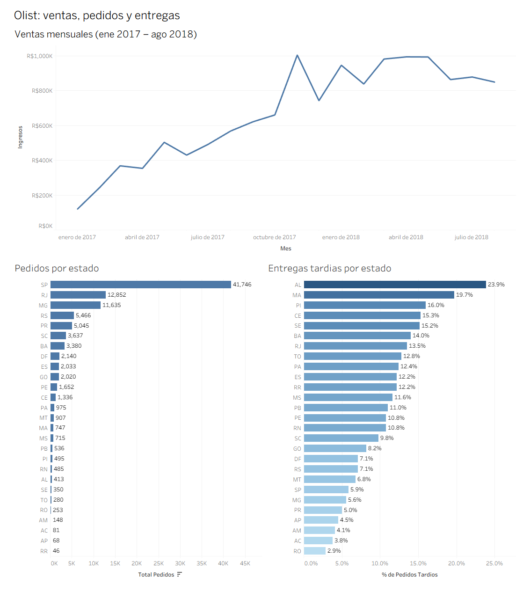

# 📈 Dashboard ejecutivo — Olist E-Commerce (Tableau)

## Problema de negocio
Resumir en una sola pantalla cómo evolucionan las ventas, dónde se concentran los pedidos y en qué regiones falla el cumplimiento de las entregas.

## Dashboard

👉 [Ver el dashboard interactivo en Tableau Public](https://public.tableau.com/app/profile/josue.flores4336/viz/Olistventaspedidosyentregas/Dashboard1)

## Datos
- Fuente: [Brazilian E-Commerce Public Dataset by Olist (Kaggle)](https://www.kaggle.com/datasets/olistbr/brazilian-ecommerce)
- Tres tablas agregadas, generadas con las consultas de [sql-analytics-olist](https://github.com/ElYaret/sql-analytics-olist) y exportadas a CSV (carpeta `data/`):
  - `ventas_mensuales.csv`: ingresos por mes, enero 2017 a agosto 2018 (solo meses completos)
  - `pedidos_por_estado.csv`: pedidos por estado del cliente
  - `entregas_por_estado.csv`: días reales vs estimados y % de entregas tardías (solo pedidos entregados)

## Qué muestra
- **Ventas mensuales:** crecimiento fuerte en 2017, con pico en noviembre 2017 (~R$1.0M), y estancamiento en 2018 (entre R$0.85M y R$1.0M).
- **Pedidos por estado:** São Paulo concentra ~42% de los pedidos (41,746), seguido de Rio de Janeiro (12,852) y Minas Gerais (11,635).
- **Entregas tardías por estado:** los atrasos se concentran en el noreste (AL 23.9%, MA 19.7%, PI 16.0%). RR, AP y AC tienen menos de 100 pedidos, por lo que sus porcentajes son poco confiables.

## Decisiones de diseño
- Las ventas excluyen los meses parciales del inicio y del final del dataset, que producían variaciones absurdas.
- Tableau Public solo se conecta a archivos, no a PostgreSQL, por eso el dashboard usa los CSV exportados.
- Gráficos organizados en contenedores, con etiquetas de valor y moneda en R$.

## Limitaciones
- Los rangos de fechas no son iguales entre gráficos: ventas cubre ene 2017 – ago 2018; pedidos y entregas cubren todo el dataset.
- Las entregas tardías solo incluyen pedidos marcados como entregados, así que los atrasos reales probablemente son mayores.

## Tecnologías usadas
Tableau Public, PostgreSQL, SQL

## Contenido del repositorio
- `dashboard.png`: captura del dashboard
- `data/`: los tres CSV
- el workbook de Tableau (`.twbx`), que se abre con Tableau Public
